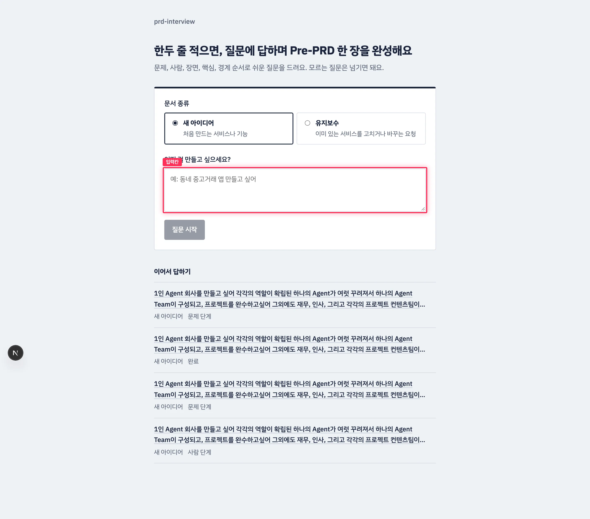
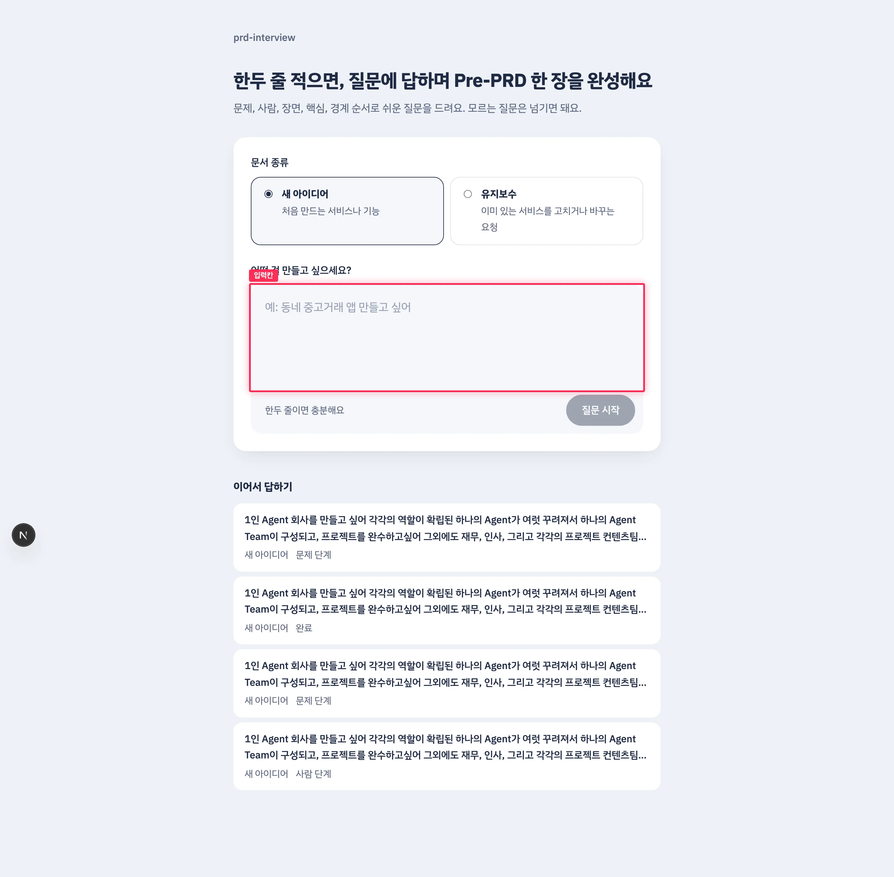
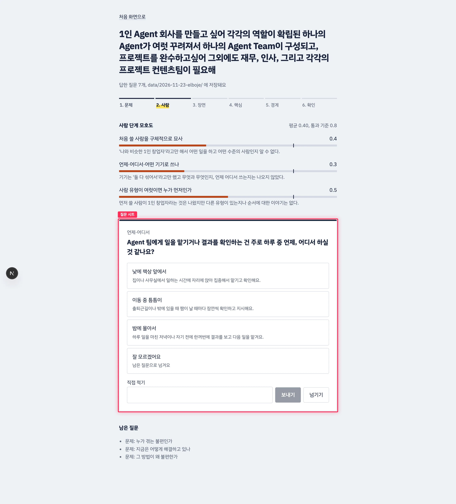
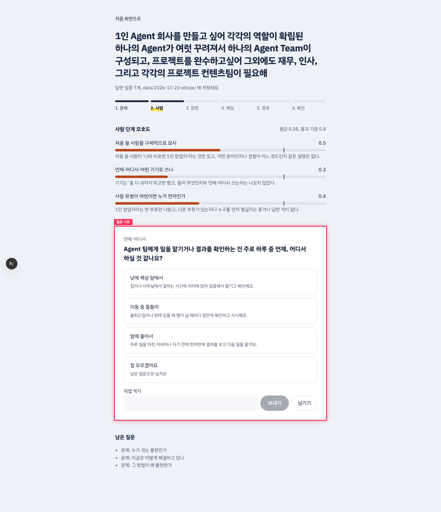
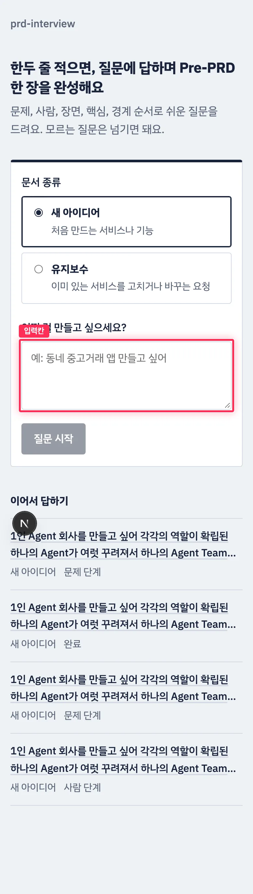
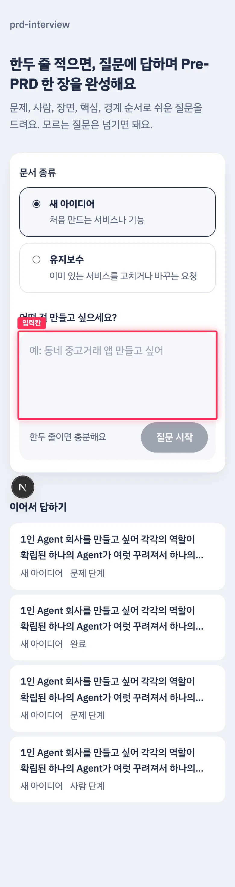
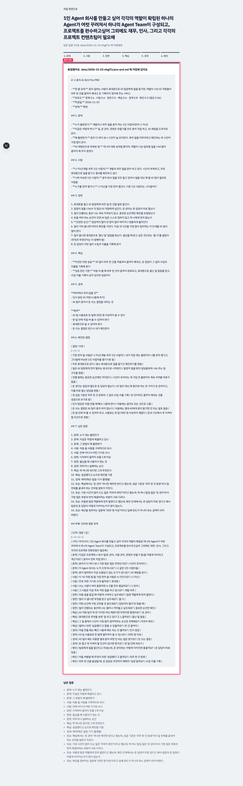
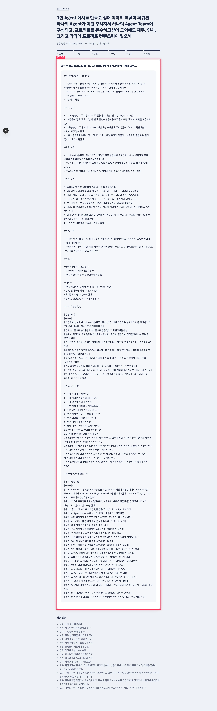
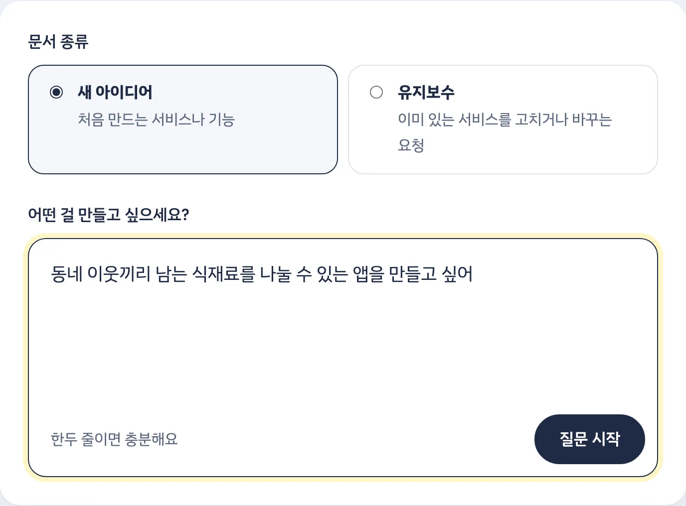

## 작업 요약

딱딱하고 각져 보이던 인상을 부드럽게 바꾸고, 아이디어 입력칸을 넉넉한 작성 상자로 다시 만들었습니다. 동작과 API 는 바뀌지 않았습니다.

## 변경 전후

| 전 | 후 |
| --- | --- |
|  |  |
|  |  |
|  |  |
|  |  |

빨간 박스는 입력칸(`#idea`)과 질문·문서 시트(`.question`)입니다.

### 입력칸에 글을 쓰는 중 (포커스)

## 달라진 점

- 모서리를 위계에 따라 둥글게: 흰 시트 20px, 선택지 16px, 입력 14~18px, 버튼 알약형. 굵은 상단 선을 없애고 시트에만 옅은 그림자
- 입력칸: 연한 배경, 높이 168px, 글자 18px, 시작 버튼을 상자 안 오른쪽 아래에 배치, 포커스 시 남색 테두리 + 형광펜색 링. 지원 브라우저(Chrome 계열)에선 글이 길어지면 상자가 늘어남
- 진행 단계와 모호도 막대를 둥근 막대로, 이어하기 목록을 흰 카드로

## 검증

- `npx tsc --noEmit`, `npm test` 10/10, `npm run build` 통과
- 390px 폭에서 가로 스크롤 없음
