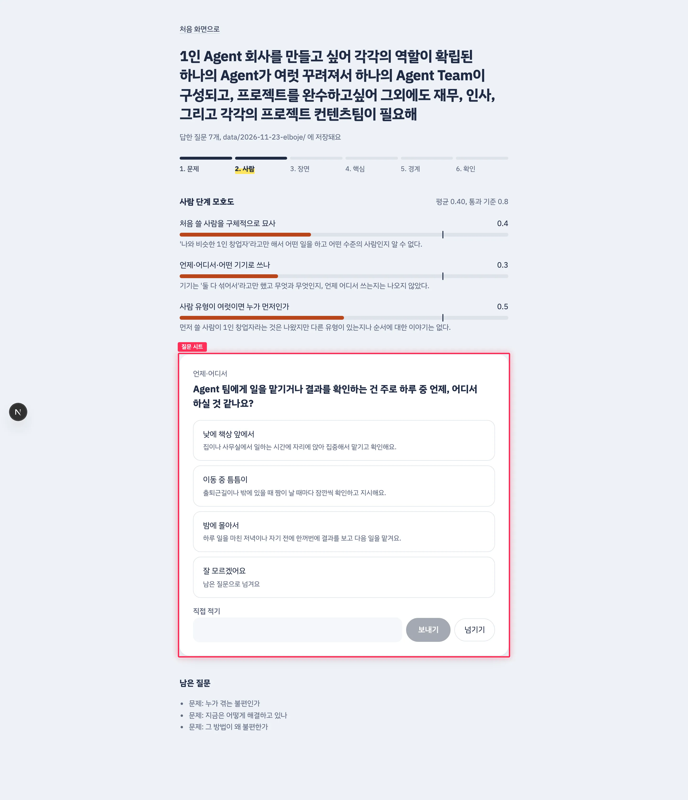
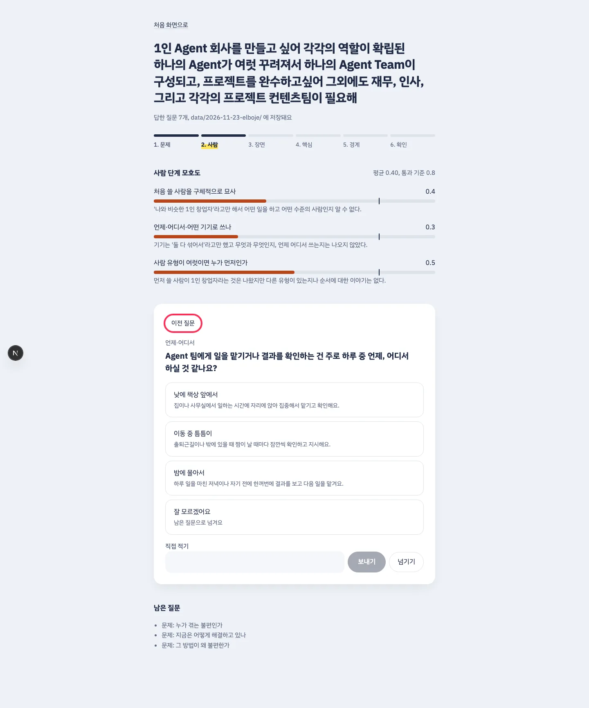
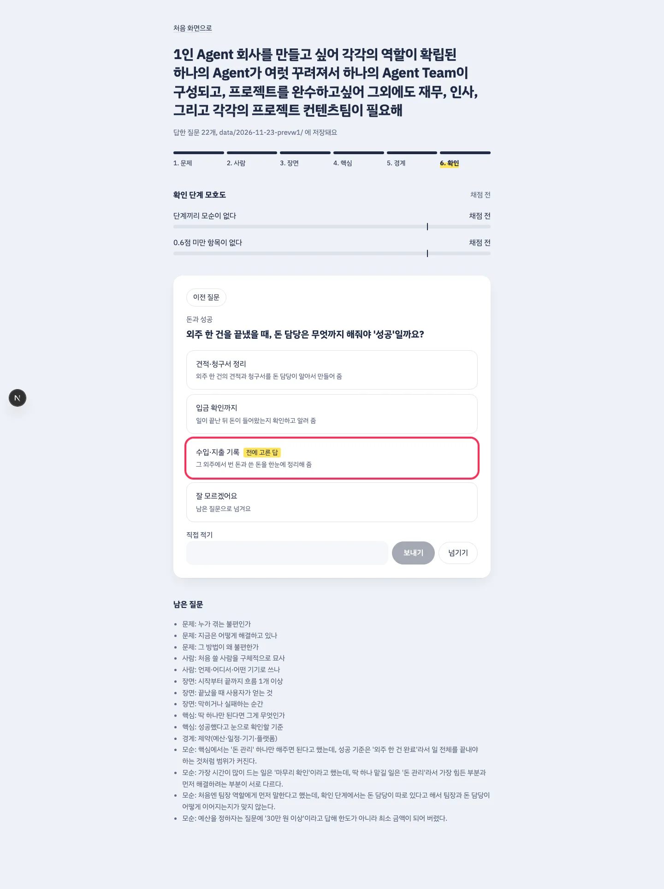
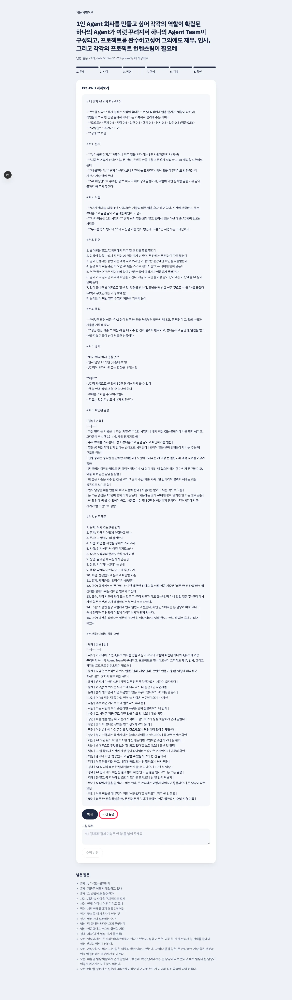
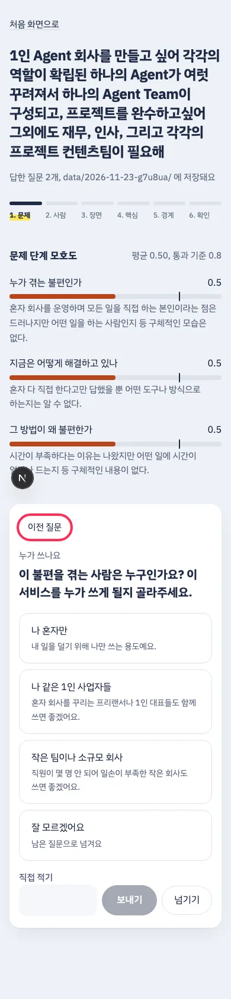

## 작업 요약

인터뷰에서 "이전 질문"으로 한 질문씩 돌아가 답을 고칠 수 있습니다. 전에 고른 답이 표시되고, 되돌린 뒤에는 남은 답으로 다시 채점합니다.

## 변경 전후

| 전 | 후 |
| --- | --- |
|  |  |

전후는 같은 세션입니다. 빨간 선은 전의 질문 시트, 후의 "이전 질문" 버튼을 가리킵니다.

### 새로 생긴 상태

| 전에 고른 답 | 미리보기 | 모바일 390px |
| --- | --- | --- |
|  |  |  |

## 검증

- `npm test` 11/11, `npx tsc --noEmit`, `npm run build` 통과
- 브라우저: 7개 답을 첫 질문까지 되돌리기, 새로고침 유지, 다시 답하기, 직접 적은 답 복원, 미리보기에서 되돌리기, 확정 문서에 버튼 없음, 390px 가로 넘침 없음
- 별도 코드 리뷰: 1차에서 질문이 건너뛰어지는 결함을 찾아 수정, 2차 승인

## 남은 한계

- 같은 단계에 추가로 만든 질문은 답을 바꿔도 남음
- 되돌린 직후 0.5초 안의 입력은 전에 적은 답으로 덮일 수 있음
- `prepared` 가 없는 옛 세션은 원래 선택지를 살릴 수 없음 (직접 적기·넘기기만)
