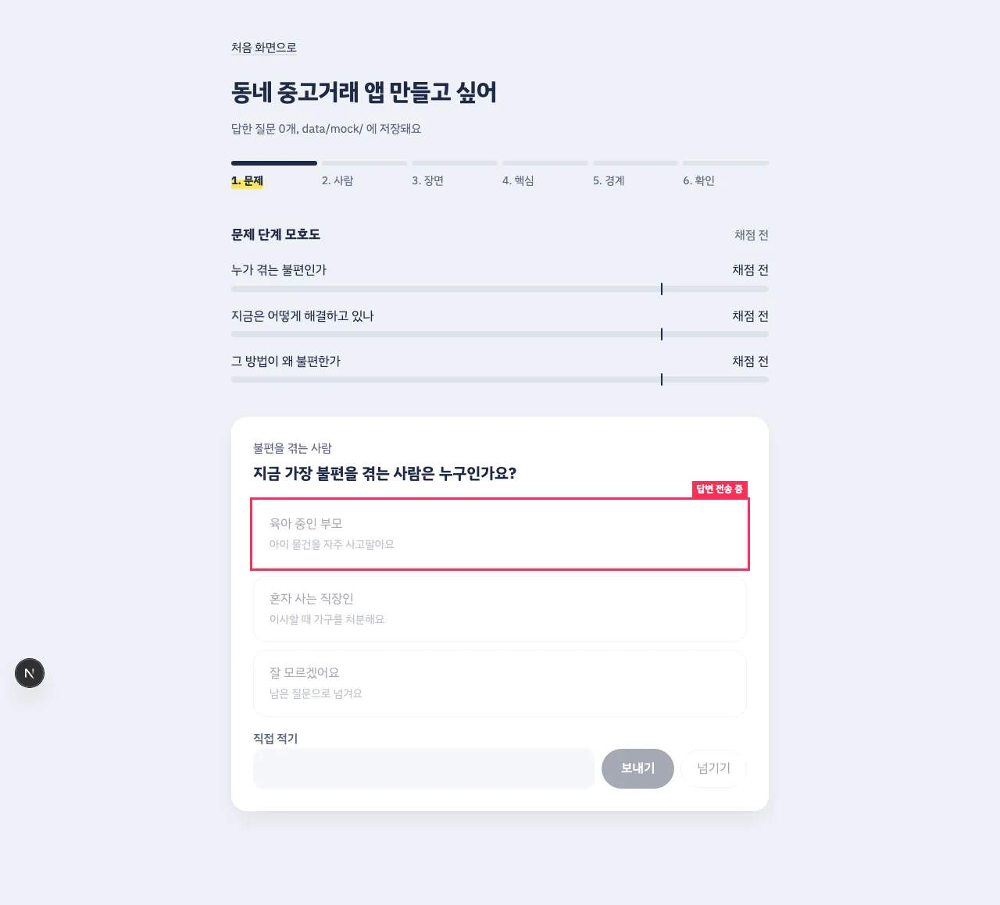
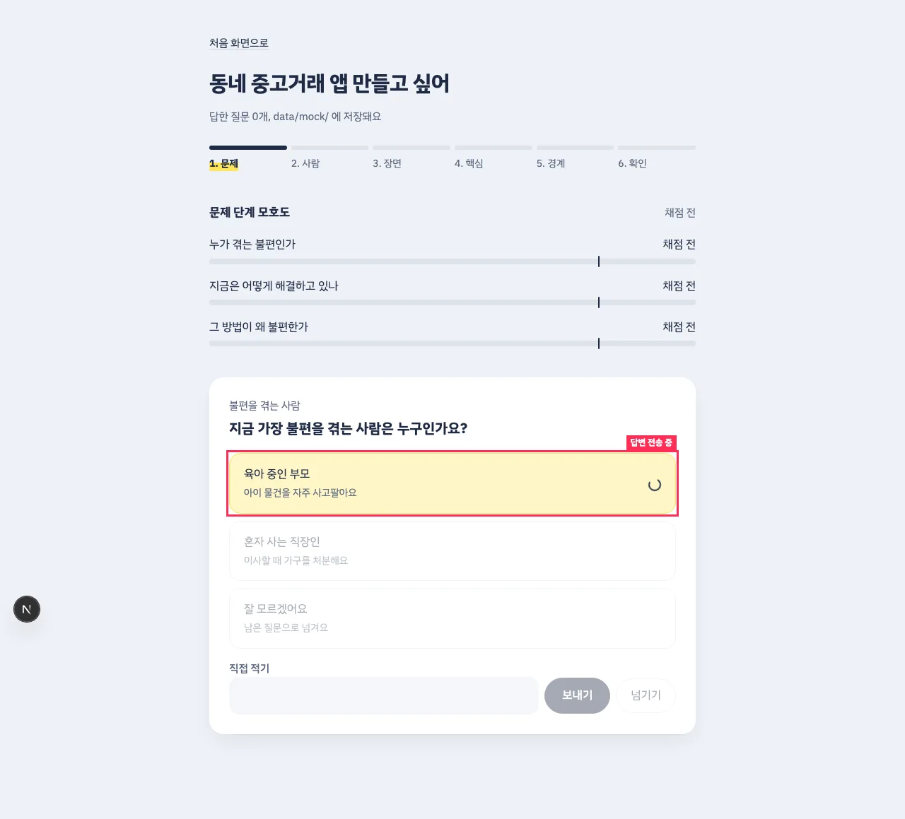
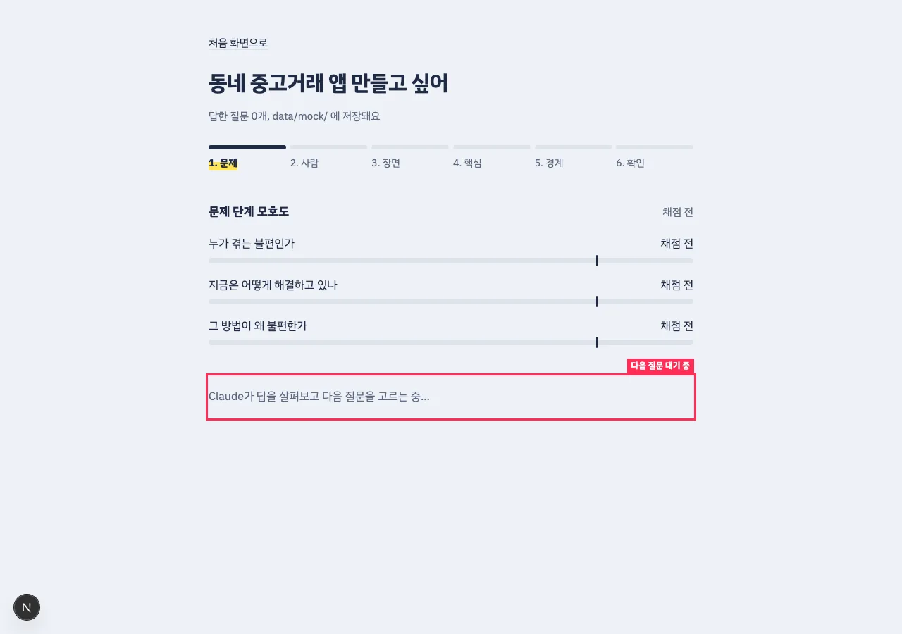
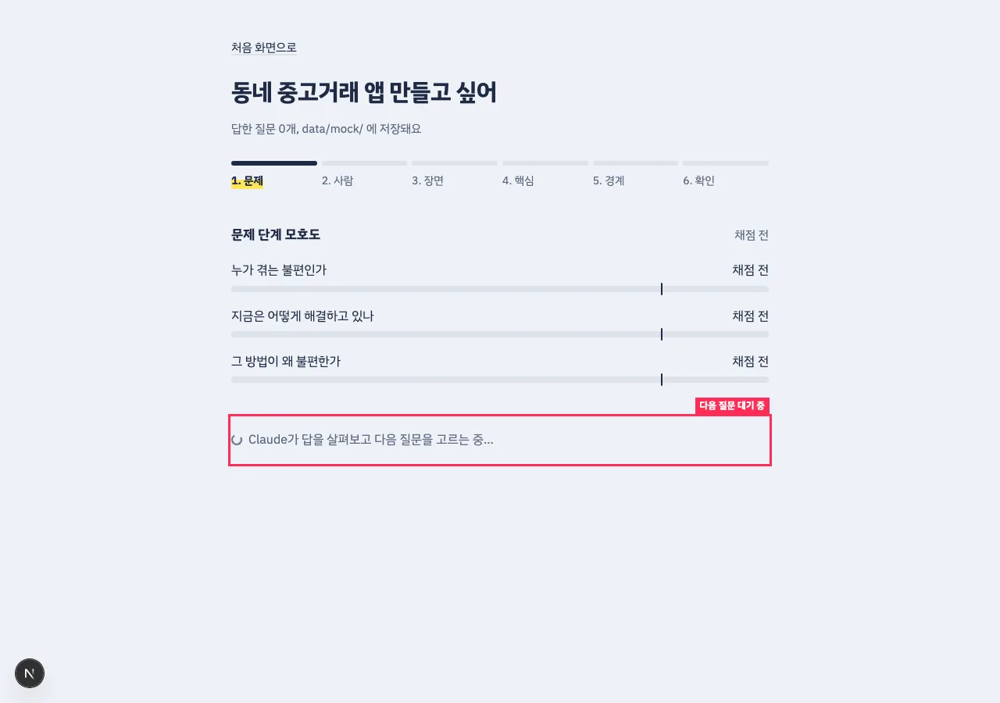
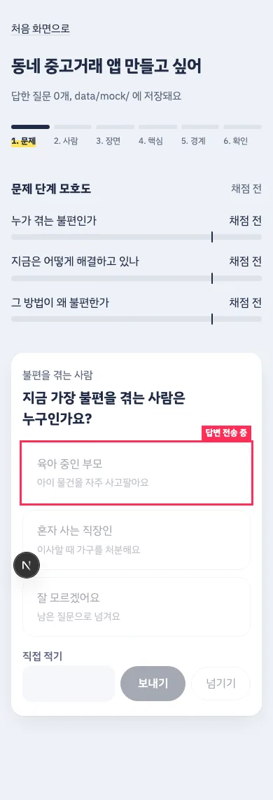
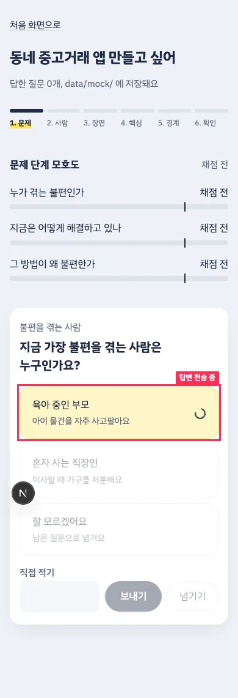
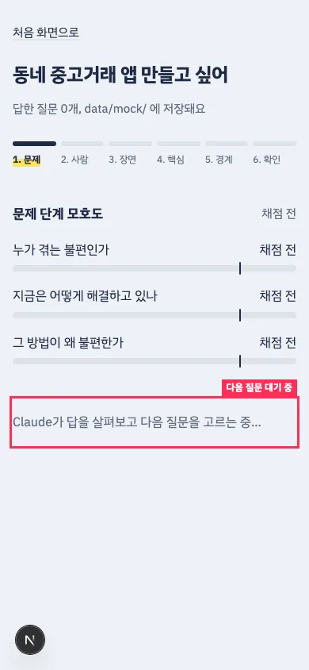

## 작업 요약

답을 보내는 동안 누른 선택지·보내기·넘기기에만 작은 로딩 표시가 나타납니다. 다음 질문을 기다리는 문구에도 같은 표시가 붙습니다. 금방 끝나는 전송에서 깜빡이지 않도록 0.15초 뒤에 나타납니다.

## 변경 전후

| 전 | 후 |
| --- | --- |
|  |  |
|  |  |

모바일 (390x844)

| 전 | 후 |
| --- | --- |
|  |  |
|  |  |

빨간 박스가 변경 구간입니다. 화면 데이터는 API 응답을 고정한 예시입니다.

## 변경 파일

- `app/page.tsx`: 누른 위치 상태(`pressed`), `aria-busy`, 상태 안내, 전송 중 Enter 차단
- `app/globals.css`: 스피너, 움직임 줄이기 설정 대응

## 검증

- `tsc --noEmit` / `npm test` (11개) / `npm run build` 통과
- 브라우저: 선택지·보내기·Enter·넘기기 각각 누른 곳에만 표시되고 끝나면 사라짐, 전송 중 Enter 재전송 안 됨, 전송 실패 시 사라짐, `prefers-reduced-motion` 에서 정지

## 남은 이슈

- 스크린리더 실기 확인은 하지 않음. 전송 실패 후 버튼 포커스가 풀릴 수 있는 기존 동작은 그대로임
