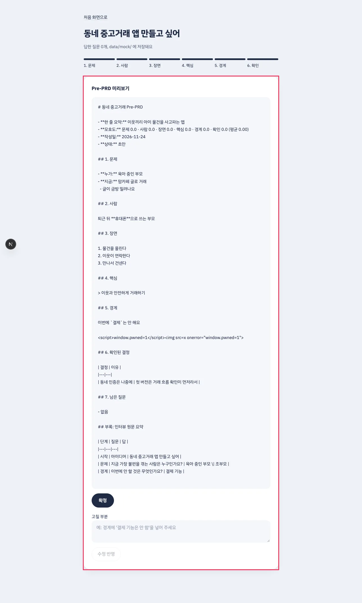
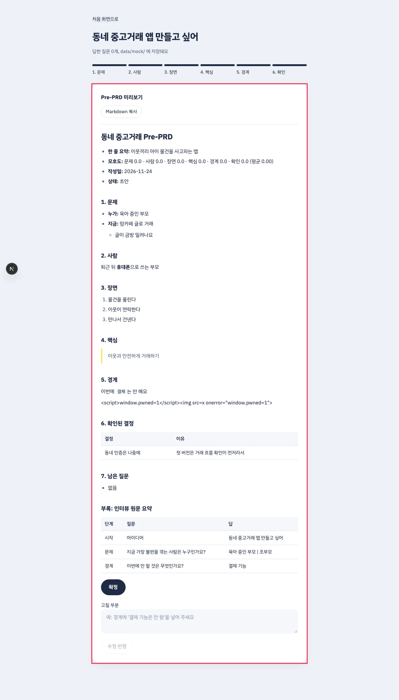
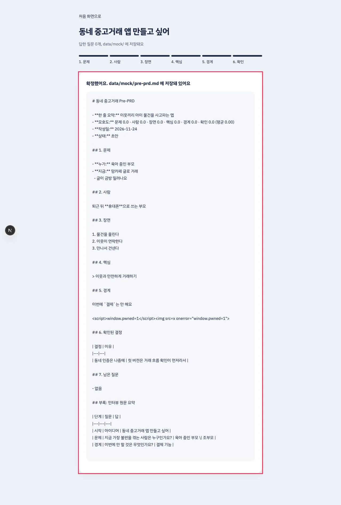
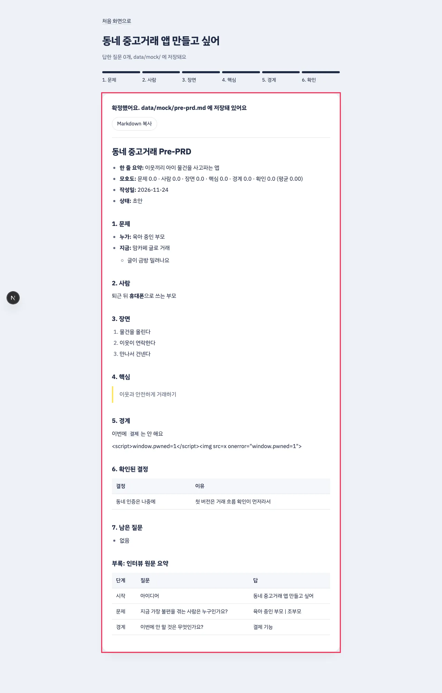
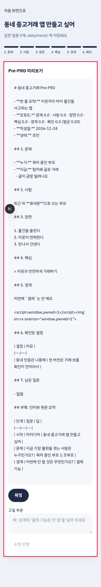
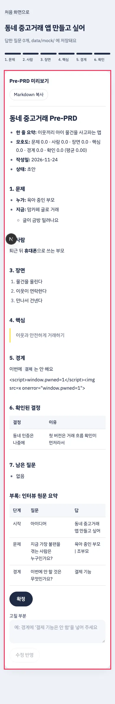
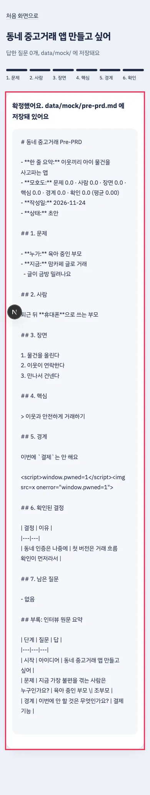
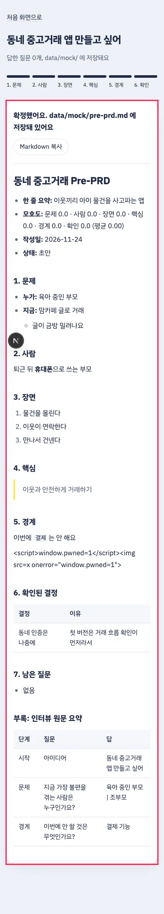

## 작업 요약

Pre-PRD 미리보기·확정 화면을 문서 형태로 보여 주고, Markdown 원문 복사 버튼과 성공·실패 안내를 추가했습니다.

## 변경 전후

| 전 | 후 |
| --- | --- |
|  |  |
|  |  |

모바일 (390x844)

| 전 | 후 |
| --- | --- |
|  |  |
|  |  |

빨간 박스가 변경 구간입니다. 화면 데이터는 API 응답을 고정한 예시이며, `<script>` 글자는 HTML이 실행되지 않는지 보려고 일부러 넣었습니다.

## 변경 파일

- `app/page.tsx`: `Document` 컴포넌트(렌더링, 복사)
- `app/globals.css`: 문서 스타일
- `package.json`, `package-lock.json`: `react-markdown`, `remark-gfm`

## 검증

- `tsc --noEmit` / `npm test` (11개) / `npm run build` 통과
- 브라우저: 복사 내용이 원문과 일치, 복사 성공·실패 안내, 본문 HTML 미실행, 표 렌더링, `3~5명` 같은 범위 표기 유지, 1280·390 폭에서 가로 넘침 없음

## 남은 이슈

- 없음
