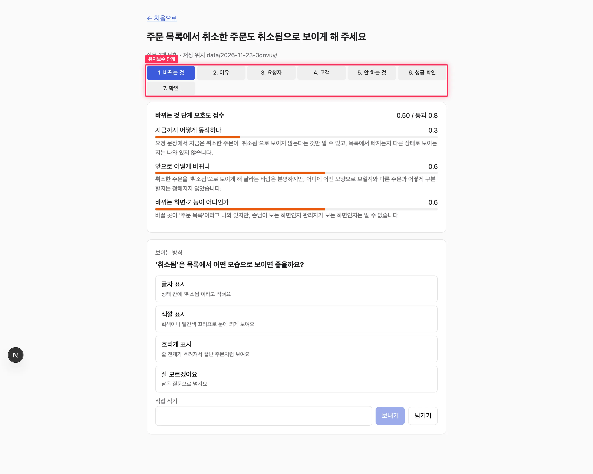
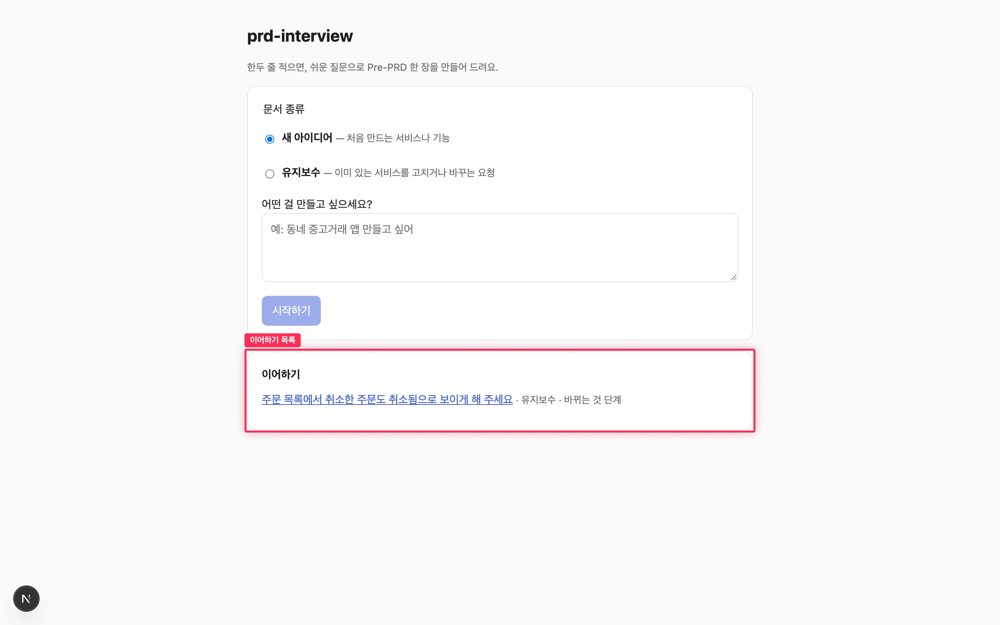

## merge 전 보강 확인 — 재열기·진행 화면

| 진행 화면 (유지보수 7단계) | 이어하기 목록 |
| --- | --- |
|  |  |

- 서버를 재시작해도 유지보수 세션이 `kind=maintenance` 로, 같은 대기 질문에서 이어짐 (답 1개 → 재시작 → 같은 질문 `qa=1`)
- 진행 화면 단계 표시·점수 막대가 유지보수 단계(바뀌는 것 · 이유 · 요청자 · 고객 · 안 하는 것 · 성공 확인 · 확인)로 나옴
- 이어하기 목록에 "유지보수 · 바뀌는 것 단계" 로 표시
