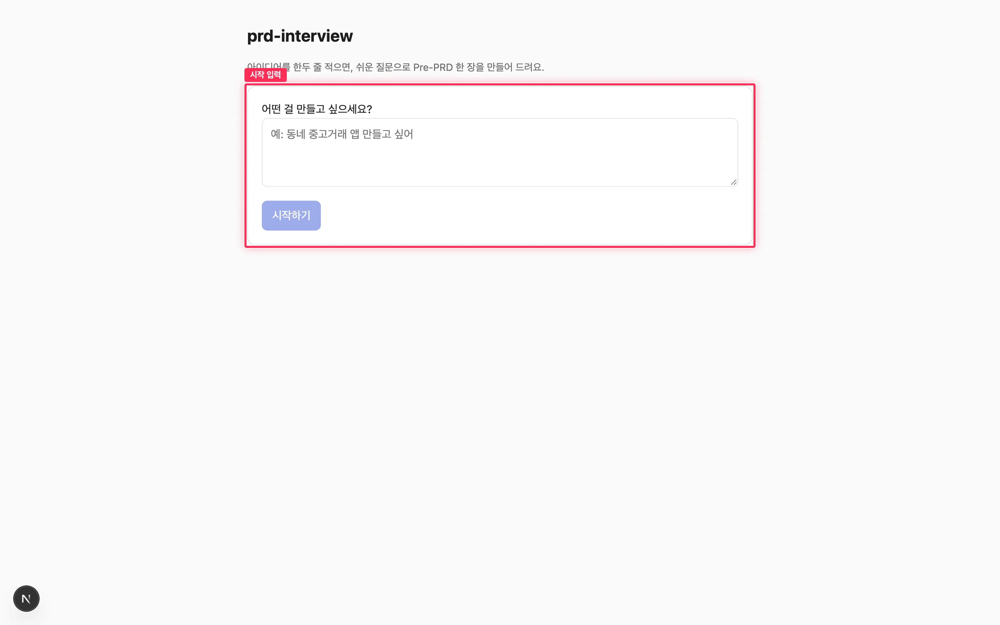
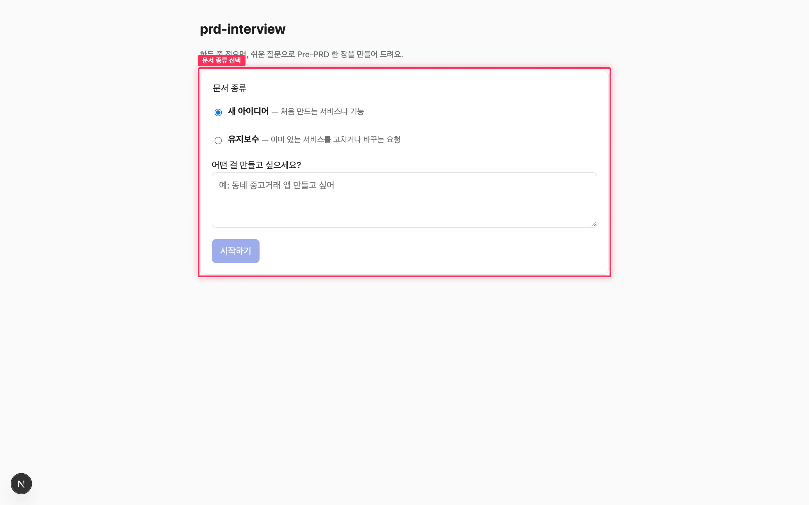

## 작업 요약

시작 화면에서 문서 종류(새 아이디어 / 유지보수)를 고를 수 있게 했습니다. 유지보수를 고르면 요청하신 형식대로 6단계 + 확인으로 묻고, 같은 제목의 Pre-PRD 를 만듭니다. 새 아이디어 흐름은 그대로입니다.

## 변경 전후

| 전 | 후 |
| --- | --- |
|  |  |

빨간 박스가 변경 구간입니다. 문서 종류 선택이 생겼고, 고른 종류에 따라 입력 안내와 예시가 바뀝니다.

## 유지보수 흐름 끝까지 검증

실제 Claude 호출로 "취소한 주문도 '취소됨'으로 보이게" 요청을 미리보기와 확정까지 진행했습니다.

| 항목 | 결과 |
| --- | --- |
| 문서 제목 구조 | 1 무엇이 바뀌나요? · 2 왜 이 기능이 필요한가요? · 3 요청자는 무엇이 필요한가요? · 4 고객은 어떤 점이 좋아지나요? · 5 이번에 안 하는 것 · 6 잘 됐는지 어떻게 아나요? · 7 확인된 결정 · 8 남은 질문 · 부록 |
| "무엇이 바뀌나요?" | **지금까지 / 앞으로 / 바뀌는 곳** 으로 나뉘어 작성됨 |
| 단계별 질문 수 | 4 · 4 · 4 · 4 · 4 · 4 · 확인 3 (총 27) |
| 답 → 다음 질문 | 확인 단계 진입 13.4초를 빼면 모두 1~17ms |
| 마지막 답 → 미리보기 | 47초 |

[만들어진 문서 전문](https://raw.githubusercontent.com/gyeolhwi/prd-interview/main/.issue/7/evidence/after-maintenance.md) · 진행 로그는 `.issue/7/evidence/e2e-maintenance.txt`

## 변경 파일

- `lib/engine.ts` — 유지보수 단계(MAINT_STAGES), `stagesOf()` / `confirmOf()`, 종류별 `toMarkdown()`
- `lib/interview.ts` — `create(idea, kind)`, 종류별 문서 작성 지시
- `app/api/sessions/route.ts` — 종류 검증
- `app/page.tsx` — 시작 화면 문서 종류 선택, 종류별 단계 표시
- `docs/pre-prd.md` — 유지보수 단계표

## 검증

- `npm test` 10/10 (유지보수 단계·문서 구조 테스트 2개 추가), `npx tsc --noEmit`, `npm run build` 통과
- 유지보수를 고른 상태의 화면 캡처와 진행 화면 캡처는 없음 (캡처 도구가 클릭을 지원하지 않음)

## 남은 이슈

- 남은 질문에 이미 답한 항목(예: "요청자: 누가 요청했나")이 계속 나옵니다. 짧은 답의 점수가 0.8 에 못 미치면 모두 남은 질문으로 넘어가는 원래 동작이라 이번 범위 밖입니다(별도 이슈 권장).
- 유지보수는 단계가 하나 많아 질문이 최대 27개까지 늘 수 있습니다.
