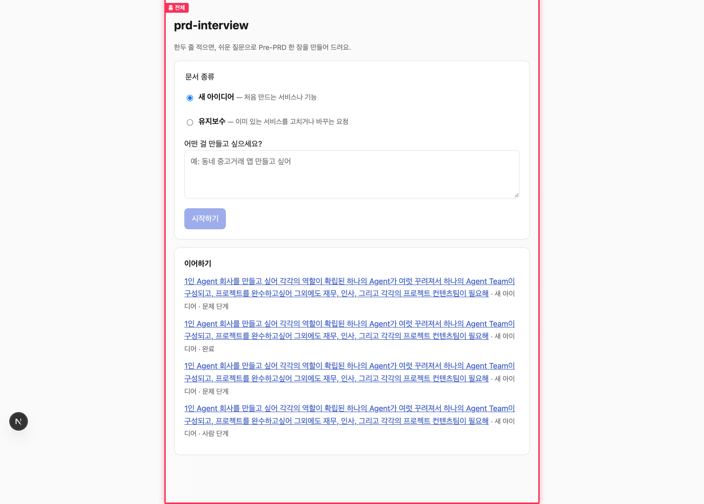
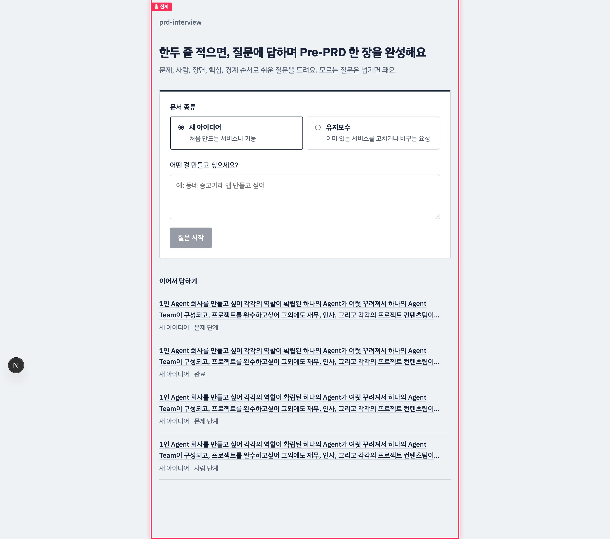
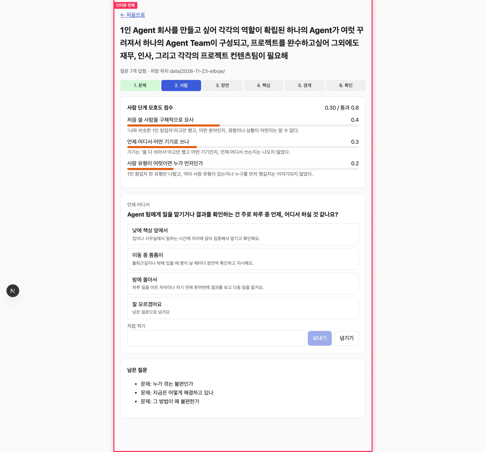
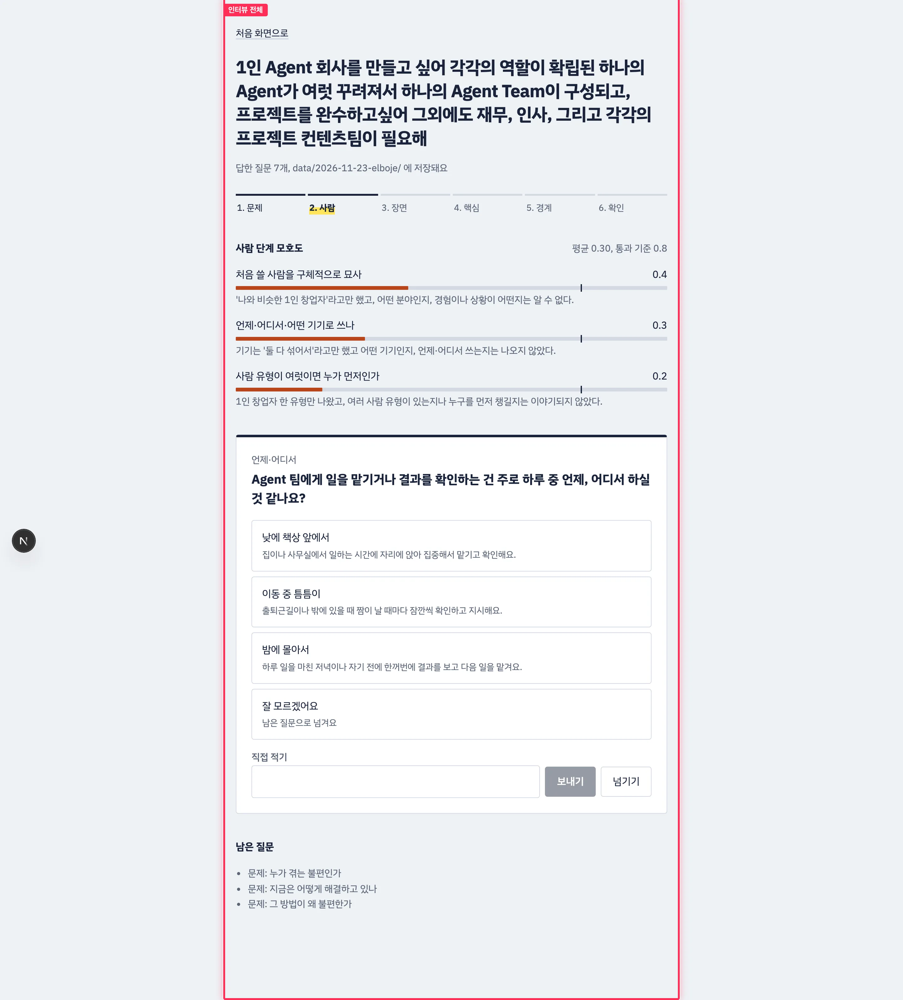
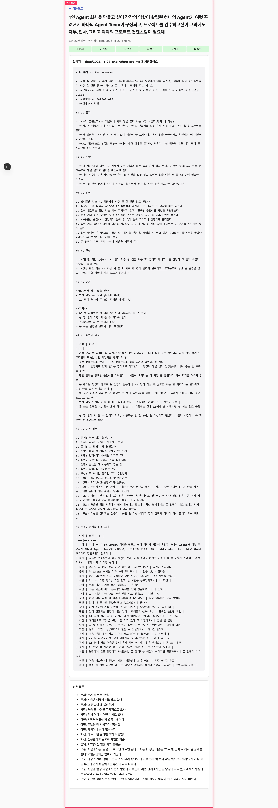
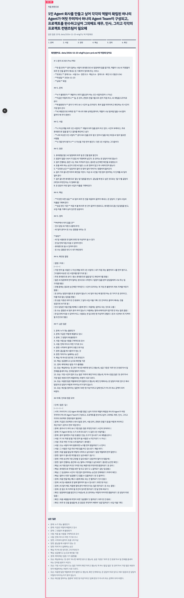
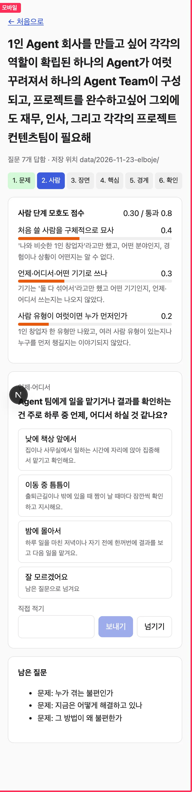
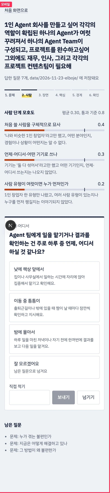

## 작업 요약

화면 전체를 '질문에 답하며 문서 한 장을 채워 가는 도구'에 맞춰 다시 정리했습니다. 회청색 종이 위에 흰 시트, 남색 잉크를 쓰고, **지금 진행 중인 단계에만 노란 형광펜**을 칠했습니다. 동작과 API 는 바뀌지 않았습니다.

## 변경 전후

| 전 | 후 |
| --- | --- |
|  |  |
|  |  |
|  |  |
|  |  |

화면 전체가 바뀌어서 빨간 박스는 `main` 영역 전체에 그렸습니다.

## 걷어낸 기본값 패턴

- system-ui 서체, 파란 강조 버튼, 같은 모양 카드 반복 → IBM Plex Sans KR 한 가지 서체, 남색 잉크 버튼, 지금 답할 질문만 시트로 띄움
- `새 아이디어 · 문제 단계` 같은 가운데 점 메타, `새 아이디어 — 설명` 라벨 → 항목을 나눠서 표시
- 색으로만 칠하던 진행 단계 → 순서를 보여 주는 선과 번호, 현재 단계에 형광펜
- 모호도 막대에 통과 기준선(0.8) 표시

## 변경 파일

- `app/globals.css` — 색 토큰, 타이포, 시트, 단계, 모호도 막대, 모바일 대응
- `app/layout.tsx` — IBM Plex Sans KR
- `app/page.tsx` — 인라인 style 정리, 마크업 구조(ol/ul), 문구 정리

## 검증

- `npx tsc --noEmit`, `npm test` 10/10, `npm run build` 통과
- 390px 폭에서 가로 스크롤 없음 (모바일 캡처)
- 질문 대기 화면은 0.5초마다 폴링해서 캡처 도구의 networkidle 대기가 끝나지 않음 → load 기준으로 캡처
